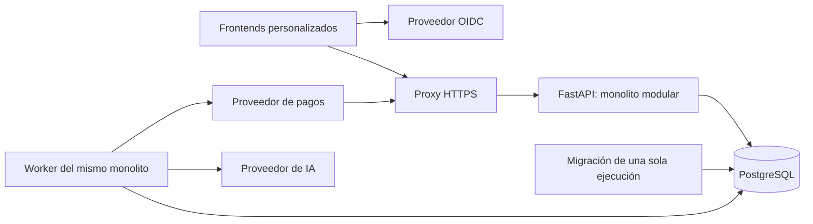
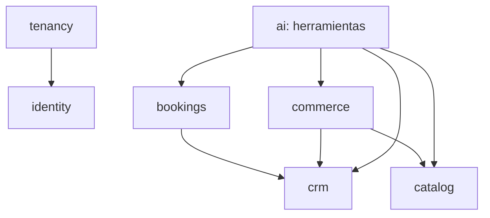

# Arquitectura de VENUX

Estado: **propuesta para revisión; no autoriza implementación**. Fecha: 2026-11-17.

## 1. Objetivo y alcance

VENUX ofrece reservas, e-commerce, CRM y agentes de IA a varias empresas mediante una API común. Cada empresa es un tenant. Los frontends pueden tener marca, navegación y despliegue propios; consumen los mismos contratos y no incorporan reglas de negocio exclusivas en el backend por nombre de empresa.

Se propone un monolito modular en Python, FastAPI y Pydantic v2, con PostgreSQL, SQLAlchemy 2, Alembic y Docker Compose. API y worker comparten repositorio, imagen, módulos y ciclo de publicación. Son procesos del mismo producto; no hay servicios de negocio independientes.

Este cambio contiene únicamente documentación. No crea paquetes Python, migraciones, contenedores ni funcionalidades. Kafka, Kubernetes y microservicios quedan fuera del diseño solicitado.

Documentos complementarios:

- [Modelo de datos](data-model.md): entidades, relaciones, restricciones y concurrencia.
- [Aislamiento multi-tenant](multi-tenancy.md): resolución, RLS, roles y excepciones.
- [Contratos REST](rest-api.md): recursos, esquemas, permisos y errores.
- [Seguridad y operación](security-and-operations.md): amenazas, Compose, recuperación y escalabilidad.
- [Registro de decisiones](adr/README.md): ADR propuestos y sus consecuencias.

## 2. Supuestos que requieren revisión

| Tema | Propuesta inicial | Límite |
| --- | --- | --- |
| Empresa | Un tenant es una empresa; un usuario puede pertenecer a varias | Sin jerarquías entre empresas ni consultas de negocio entre tenants |
| Usuarios | Personal y clientes autenticados mediante un proveedor OIDC | Proveedor y alta de usuarios por elegir; sin login anónimo ni contraseñas locales |
| Reservas | Un recurso de capacidad uno por reserva; disponibilidad publicada en intervalos | Sin recurrencias, aforo grupal ni reservas de múltiples recursos |
| Catálogo | Productos simples, un precio y una moneda por tenant | Sin variantes, promociones ni marketplace |
| Venta | Pedido directo, stock en una ubicación lógica y pago externo | Sin carrito persistente, logística, facturación fiscal ni devoluciones automáticas |
| Reservas y ventas | Comparten contactos; son procesos independientes | Cobrar una reserva mediante un pedido requiere definir reglas antes de añadir esa relación |
| CRM | Contactos y actividades de seguimiento | Sin campañas, scoring ni un motor configurable de embudos |
| IA | Conversaciones y ejecuciones delegadas, con herramientas registradas | Sin SQL libre, navegación arbitraria, entrenamiento ni base vectorial |
| Operación | Un servidor con Docker Compose y PostgreSQL primario | No proporciona alta disponibilidad ante la pérdida del servidor |

Los impuestos, monedas admitidas, cancelaciones comerciales, plazos de retención, proveedor de pagos y proveedor/modelos de IA deben acordarse antes de desarrollar los flujos afectados. El modelo reserva sus límites sin dar esas reglas por implementadas.

## 3. Vista de contexto y ejecución



El proxy termina TLS y enruta a la API. FastAPI organiza la presentación mediante routers por módulo; esto es una composición interna de la aplicación, compatible con su [patrón oficial de aplicaciones con múltiples archivos](https://fastapi.tiangolo.com/tutorial/bigger-applications/).

La API confirma operaciones locales en transacciones cortas. Las llamadas lentas a IA y pagos se ejecutan mediante trabajos durables almacenados en PostgreSQL. La respuesta HTTP de aceptación no equivale a que una operación externa haya terminado.

## 4. Módulos y propiedad

| Módulo | Responsabilidad y datos propios | Contrato interno publicado |
| --- | --- | --- |
| `identity` | Identidad global vinculada a OIDC; perfil del usuario | `ResolvePrincipal`, `GetOwnIdentity` |
| `tenancy` | Empresas, membresías, roles, orígenes de frontend y estado del tenant | `ResolveTenantContext`, `Authorize`, `ListOwnTenants` |
| `crm` | Contactos y actividades; vinculación opcional entre contacto y usuario cliente | `GetContact`, `GetOwnContact`, `CreateContact`, `RecordActivity` |
| `catalog` | Productos, SKU, precio vigente y publicación | `GetProductsForOrder`, `SearchProducts`, `ManageProduct` |
| `bookings` | Recursos, intervalos de disponibilidad y reservas | `SearchAvailability`, `CreateBooking`, `CancelBooking` |
| `commerce` | Inventario, pedidos, líneas congeladas, pagos y eventos del proveedor | `CreateOrder`, `CancelOrder`, `StartPayment`, `GetOrder` |
| `ai` | Agentes, conversaciones, mensajes, ejecuciones y propuestas de herramientas | `StartRun`, `GetRun`, `DecideToolInvocation` |

`platform` es infraestructura compartida para jobs, idempotencia, auditoría, conexiones, reloj y observabilidad. No contiene reglas de reservas, ventas o CRM. Sus interfaces puras viven en un kernel pequeño; los adaptadores concretos se conectan en el punto de composición.

### Dependencias permitidas

Una flecha significa «consume contratos de aplicación de»:



- `identity`, `crm` y `catalog` no dependen de otros módulos de negocio.
- La composición resuelve identidad y tenancy antes de invocar los casos de uso. Todos reciben un contexto inmutable y una política de autorización a través de puertos; eso no añade importaciones hacia la infraestructura de tenancy.
- `ai` llama contratos existentes; los módulos de negocio no conocen modelos, prompts ni proveedores de IA.
- Las dependencias cruzadas se limitan a contratos públicos de `application`. No se importan entidades de dominio, repositorios ni modelos ORM de otro módulo.
- No hay consultas ORM ni escrituras directas sobre tablas ajenas. Las FK entre módulos son restricciones de infraestructura expresamente documentadas, no permiso para compartir repositorios.
- No se introduce un bus genérico. La consistencia inmediata utiliza llamadas explícitas; los efectos externos utilizan jobs persistidos junto con la operación local.

## 5. Clean Architecture dentro de cada módulo

| Capa | Contenido | Puede depender de |
| --- | --- | --- |
| `domain` | Entidades, objetos de valor, invariantes y errores de negocio | Python estándar y tipos puros del kernel |
| `application` | Casos de uso, comandos/resultados y puertos de repositorio/proveedores | Dominio propio, kernel y contratos públicos autorizados |
| `infrastructure` | SQLAlchemy, clientes OIDC/pagos/IA, repositorios y adaptadores | Aplicación y dominio propios |
| `presentation` | Routers FastAPI, esquemas Pydantic v2 y traducción HTTP | Contratos de aplicación y tipos de transporte |

La dirección de las dependencias es hacia dentro. `domain` y `application` no importan FastAPI, Pydantic, SQLAlchemy ni SDK de proveedores. Los modelos Pydantic y ORM se convierten a comandos y entidades; no constituyen el dominio.

Organización prevista, **sin crear estos directorios en esta etapa**:

```text
src/venux/
  bootstrap/              # Composición de API y worker; único ensamblador de adaptadores
  kernel/                 # TenantContext, Actor, Money, puertos de UoW/auditoría/jobs
  platform/               # Adaptadores comunes, sin reglas comerciales
  modules/
    <modulo>/
      domain/
      application/        # Incluye contratos públicos estables
      infrastructure/
      presentation/
alembic/                  # Una historia de migraciones para toda la base
tests/                    # Dominio, integración PostgreSQL, contratos y aislamiento
```

Un contrato publicado usa tipos puros, identificadores y resultados explícitos. Nunca entrega una sesión SQLAlchemy, un modelo ORM ni una entidad mutable del módulo proveedor. El kernel no crece hasta convertirse en un dominio compartido de contactos, pedidos o reservas.

## 6. Transacciones y coordinación

Un caso de uso de entrada posee la unidad de trabajo. Los contratos internos se incorporan a esa misma unidad de trabajo a través de los adaptadores de composición; no abren transacciones ni hacen `commit` de forma independiente. Cada repositorio escribe únicamente datos de su módulo.

Se propone SQLAlchemy 2 con `AsyncSession` y un driver PostgreSQL asíncrono. Cada petición o ejecución concurrente tiene su propia sesión; no se comparte entre tareas, conforme a la [documentación de SQLAlchemy](https://docs.sqlalchemy.org/en/20/orm/extensions/asyncio.html#using-asyncsession-with-concurrent-tasks). La aplicación controla el límite transaccional; la infraestructura materializa la sesión.

Secuencia común:

1. Validar identidad, tenant, permisos y límites de entrada.
2. Abrir transacción, establecer contexto local y revalidar membresía/tenant.
3. Cargar agregados mediante puertos, comprobar invariantes y aplicar cambios.
4. Persistir cambios, auditoría, registro de idempotencia y jobs necesarios en la misma transacción.
5. Confirmar y construir la respuesta; ante cualquier fallo, revertir todo.

No se mantiene una transacción ni un bloqueo mientras se espera al proveedor externo. Los reintentos usan claves estables y restricciones únicas. Los jobs tienen entrega al menos una vez; el diseño no promete ejecución exactamente una vez.

### Flujos principales

| Flujo | Coordinación |
| --- | --- |
| Crear reserva | `bookings` consulta contacto por contrato CRM, bloquea recurso, valida disponibilidad e inserta reserva; PostgreSQL rechaza solapamientos |
| Crear pedido | `commerce` obtiene productos por contrato de catálogo, congela precios, reserva stock y agenda vencimiento en una transacción |
| Solicitar pago | `commerce` crea intento y job; worker invoca pasarela con idempotencia; webhook verificado confirma el resultado |
| Ejecutar agente | `ai` registra mensaje/run y job; worker consulta al modelo fuera de transacción; cada herramienta pasa autorización y casos de uso normales |
| Herramienta que modifica datos | Se persiste propuesta, una persona autorizada aprueba argumentos concretos y el worker revalida permisos antes de ejecutarla |

## 7. API común y personalización

La API se versiona bajo `/api/v1`. Los recursos empresariales usan `/tenants/{tenant_id}` como selector explícito; el servidor comprueba membresía y estado en cada operación. El selector no acredita acceso. No se acepta un `tenant_id` de escritura en el body ni se usa `Origin` como identidad.

Los frontends obtienen capacidades y empresas accesibles desde la API. Ocultar un botón no sustituye autorización. La marca y los componentes visuales se resuelven en cada frontend. Los orígenes autorizados y los clientes OIDC se registran por empresa sin crear variantes de API.

El alcance inicial propuesto exige autenticación, también para clientes finales. Una tienda o agenda pública anónima queda pendiente de revisión: necesitaría contratos públicos de lectura y reglas específicas de alta y abuso.

## 8. Datos, aislamiento y operación

Una base y tablas compartidas por módulo; cada fila empresarial lleva `tenant_id NOT NULL`. Filtros explícitos en repositorios, FK compuestas y RLS constituyen capas complementarias. Las excepciones de identidad, bootstrap y despacho están enumeradas en [multi-tenancy](multi-tenancy.md); no hay un bypass global para administradores de empresa.

Docker Compose describe proxy, API, worker, PostgreSQL y una tarea de migración. Se escala primero mediante índices, consultas acotadas, pools y concurrencia limitada; después se pueden replicar procesos del mismo monolito. Un servidor sigue siendo un punto de fallo. El detalle y las pruebas de recuperación se definen en [seguridad y operación](security-and-operations.md).

## 9. Revisión previa al código

Todas las decisiones de los [ADR](adr/README.md) están **propuestas**, no aceptadas. La revisión debe confirmar:

- Límites de módulos y ausencia de venta/cobro automático de reservas.
- Alcance de clientes autenticados, onboarding y proveedor OIDC.
- Restricciones de reservas, moneda, stock, impuestos, cancelaciones y conciliación de pagos tardíos.
- Roles y políticas de acceso a datos propios; excepciones de bootstrap y worker a las políticas habituales.
- Proveedor de IA, tratamiento de datos y acciones que requieren aprobación humana.
- Objetivos de disponibilidad, recuperación, retención y carga esperada.

Tras aprobación expresa se podrá planificar el código. El primer entregable de implementación deberá validar aislamiento con PostgreSQL real y los límites de importación antes de añadir los flujos comerciales. Esta propuesta no inicia esa implementación.
