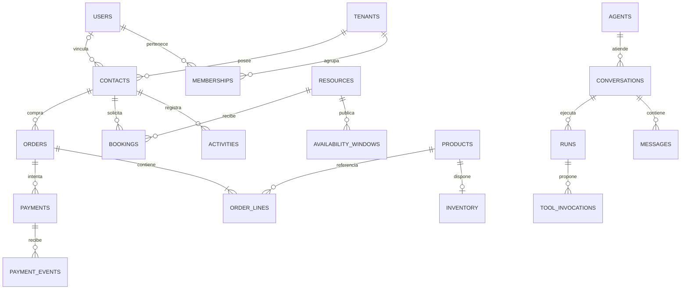

# Modelo de datos inicial

Estado: **propuesto para revisión**. Complementa [architecture.md](architecture.md). Es un modelo lógico; no contiene migraciones ni DDL ejecutable.

## 1. Convenciones

- Una base PostgreSQL. Esquemas por módulo: `identity`, `tenancy`, `crm`, `catalog`, `bookings`, `commerce`, `ai` y `platform`. Los esquemas indican propiedad; no separan empresas.
- PK `id UUID` generada por la aplicación. Toda tabla empresarial tiene además `tenant_id UUID NOT NULL`, FK a `tenancy.tenants.id`, y `UNIQUE (tenant_id, id)` para referencias compuestas.
- Salvo indicación contraria, todas las tablas tienen `created_at` y `updated_at` de tipo `timestamptz`; los campos son obligatorios excepto los marcados `?`. Filas mutables expuestas a edición incluyen `version INTEGER >= 1` para control optimista.
- Fechas de instante en UTC; zona IANA en tenant/recurso para presentación y reglas locales. JSON transporta RFC 3339 con offset. No se guarda un horario local ambiguo como instante.
- Dinero como `NUMERIC(20,6)` y moneda ISO 4217; nunca `float`. Validar escala de la moneda, importes no negativos y redondeo explícito. JSON usa cadenas decimales.
- Estados como texto con `CHECK`; transiciones comprobadas por dominio. `JSONB` solo para metadatos, configuración validada y payloads de proveedor; no reemplaza columnas, FK ni permisos.
- No hay borrado en cascada de historia comercial. Productos, recursos y contactos se archivan. Anonimización y purga se diseñan al acordar retención; no se aplica un `deleted_at` universal.

## 2. Relaciones principales

Todas las relaciones entre entidades empresariales incluyen el tenant en su FK, aunque el diagrama lo omita. Un evento de pago puede permanecer sin pago asociado mientras se concilia.

## 3. Identidad y tenancy

| Tabla | Campos de negocio | Restricciones y acceso |
| --- | --- | --- |
| `identity.users` | `id`, `issuer`, `subject`, `display_name`, `email?`, `status` | Global; `UNIQUE (issuer, subject)`. Email no es identidad ni debe ser único globalmente. Estados `active/disabled`; RLS permite consultar el perfil propio |
| `tenancy.tenants` | `id`, `slug`, `name`, `status`, `timezone`, `currency`, `order_hold_minutes`, `version` | Registro global; slug único normalizado. Estados `active/suspended`. Moneda inmutable cuando existe historia comercial; hold positivo y acotado |
| `tenancy.memberships` | `tenant_id`, `id`, `user_id`, `role`, `status`, `version` | FK global a usuario; `UNIQUE (tenant_id, user_id)`; roles `owner/admin/staff/customer`, estados `active/revoked` |
| `tenancy.frontend_origins` | `tenant_id`, `id`, `origin`, `oidc_client_id`, `version` | `UNIQUE (tenant_id, origin, oidc_client_id)`; origen exacto sin path; HTTPS excepto desarrollo local |

Solo `users` y `tenants` carecen de `tenant_id`; sus políticas especiales están en [multi-tenancy](multi-tenancy.md). El alta inicial de tenant, usuario y primer owner es una operación de control auditada fuera de la API comercial propuesta. No se permite eliminar/revocar al último owner activo; la operación bloquea la fila del tenant antes de contar y modificar owners.

El `oidc_client_id` registra una asociación de frontend, no un secreto ni una prueba de acceso. La API valida el audience de sus access tokens según el proveedor; no espera recibir ID tokens como credencial.

## 4. CRM

| Tabla | Campos de negocio | Restricciones |
| --- | --- | --- |
| `crm.contacts` | `tenant_id`, `id`, `user_id?`, `kind`, `display_name`, `email?`, `phone?`, `status`, `version` | `kind=person/company`, `status=active/archived`; FK global opcional a usuario; `UNIQUE (tenant_id, user_id)` cuando existe vínculo |
| `crm.activities` | `tenant_id`, `id`, `contact_id`, `author_membership_id`, `kind`, `summary`, `occurred_at` | FK compuestas a contacto y membresía; append-only; tipos iniciales `note/call/meeting` |

Un contacto puede existir sin cuenta. Un cliente autenticado accede únicamente al contacto vinculado a su usuario en ese tenant. El vínculo lo administra personal autorizado; un cliente no puede asociarse al contacto de otra persona suministrando su ID. Email y teléfono no se usan para deducir propiedad automáticamente.

Crear una reserva o pedido exige contacto activo. Archivarlo conserva la historia y no impide conciliar un pago ya iniciado; sí impide nuevas operaciones comerciales vinculadas a él.

## 5. Catálogo

| Tabla | Campos de negocio | Restricciones |
| --- | --- | --- |
| `catalog.products` | `tenant_id`, `id`, `sku`, `name`, `description?`, `unit_price`, `currency`, `status`, `version` | `UNIQUE (tenant_id, sku)` normalizado; precio no negativo; estados `draft/active/archived`; moneda igual a la del tenant |

El precio actual pertenece al catálogo; el precio de una venta pertenece a su línea de pedido. Archivar un producto impide nuevas ventas y conserva referencias históricas. No se modelan categorías, variantes ni listas de precios hasta que se soliciten.

## 6. Reservas

| Tabla | Campos de negocio | Restricciones |
| --- | --- | --- |
| `bookings.resources` | `tenant_id`, `id`, `name`, `timezone`, `status`, `version` | Estados `active/archived`; capacidad inicial fija en uno |
| `bookings.availability_windows` | `tenant_id`, `id`, `resource_id`, `starts_at`, `ends_at`, `version` | FK compuesta a recurso; `starts_at < ends_at`; intervalos publicados finitos, sin recurrencia |
| `bookings.bookings` | `tenant_id`, `id`, `resource_id`, `contact_id`, `starts_at`, `ends_at`, `status`, `created_by_membership_id`, `cancelled_at?`, `cancellation_reason?`, `version` | FK compuestas a recurso, contacto CRM y membresía; `starts_at < ends_at`; rango no vacío |

Estados: `confirmed -> cancelled`, `confirmed -> completed` o `confirmed -> no_show`. Crear confirma inmediatamente. Solo personal puede marcar completada/ausente; solo después del fin previsto. El cliente puede cancelar una reserva propia futura bajo la política comercial por aprobar.

No solapar reservas del mismo recurso mediante exclusión GiST sobre igualdad de `tenant_id/resource_id` y solapamiento de `tstzrange(starts_at, ends_at, '[)')` para estados `confirmed/completed/no_show`. La extensión PostgreSQL `btree_gist` permite combinar UUID con rangos. Incluir estados históricos impide liberar retroactivamente una ocupación al completarla. PostgreSQL documenta estas [restricciones sobre rangos](https://www.postgresql.org/docs/current/rangetypes.html#RANGETYPES-CONSTRAINT).

La reserva debe caber íntegra en una ventana publicada; las ventanas del mismo recurso no se solapan. Crear/cancelar reserva y modificar ventanas bloquean primero el recurso dentro del tenant. Eliminar o reducir una ventana se rechaza si deja fuera una reserva futura confirmada. La exclusión protege contra carreras entre inserciones; el bloqueo del recurso protege la coherencia con la disponibilidad.

La consulta de disponibilidad es orientativa: otra transacción puede ocupar el intervalo antes del POST. El conflicto final devuelve `409 booking_overlap`. Una reprogramación se diseña después de acordar su política; inicialmente se cancela y crea con confirmación explícita del cliente.

## 7. Comercio y pagos

| Tabla | Campos de negocio | Restricciones |
| --- | --- | --- |
| `commerce.inventory` | `tenant_id`, `id`, `product_id`, `on_hand`, `reserved`, `version` | FK compuesta a producto; `UNIQUE (tenant_id, product_id)`; `0 <= reserved <= on_hand`; cantidades enteras |
| `commerce.orders` | `tenant_id`, `id`, `number`, `contact_id`, `status`, `currency`, `total_amount`, `expires_at`, `created_by_membership_id`, `reconciliation_required`, `version` | FK compuestas a contacto y membresía; `UNIQUE (tenant_id, number)`; estados `pending_payment/paid/cancelled` |
| `commerce.order_lines` | `tenant_id`, `id`, `order_id`, `product_id`, `sku_snapshot`, `name_snapshot`, `quantity`, `unit_price`, `line_total` | FK compuestas a pedido/producto; cantidad positiva; `UNIQUE (tenant_id, order_id, product_id)`; líneas inmutables |
| `commerce.payment_accounts` | `tenant_id`, `id`, `provider`, `external_account_ref`, `secret_ref`, `status`, `version` | Referencia a secreto externo al payload; `UNIQUE (provider, external_account_ref)` para enrutar una cuenta a una empresa; sin exponer referencias internas |
| `commerce.payments` | `tenant_id`, `id`, `order_id`, `payment_account_id`, `provider_payment_id?`, `amount`, `currency`, `status`, `provider_idempotency_key`, `checkout_url?`, `failure_code?`, `version` | FK compuestas a pedido/cuenta; ID proveedor único por cuenta cuando existe; clave única por cuenta; estados `pending/succeeded/failed` |
| `commerce.payment_events` | `tenant_id`, `id`, `payment_account_id`, `payment_id?`, `provider_event_id`, `event_type`, `received_at`, `payload`, `processing_status`, `processed_at?` | FK compuestas a cuenta/pago; `UNIQUE (tenant_id, payment_account_id, provider_event_id)`; estados `received/processed/failed` |

Un pedido tiene al menos una línea, todas en la moneda del tenant. Inicialmente `line_total = quantity * unit_price` y `total_amount = suma(line_total)`; son importes finales mostrados al cliente. No se calculan impuestos ni envío en esta etapa. Su tratamiento fiscal y comercial debe revisarse antes de aceptar cobros reales. El servidor calcula todos los importes; el cliente solo propone productos y cantidades.

`on_hand` representa unidades no vendidas y `reserved` unidades comprometidas en pedidos pendientes. Disponible = `on_hand - reserved`.

Comercio crea la fila de inventario al primer ajuste autorizado; un producto sin fila tiene disponible cero. Catálogo no llama a comercio. Una cuenta receptora del proveedor se asocia a un solo tenant en esta propuesta; usar una cuenta de plataforma compartida requeriría revisar el modelo de enrutamiento y conciliación.

### Consistencia de stock y pedidos

1. Crear pedido obtiene una lectura consistente del catálogo, valida productos activos y congela los precios de esa lectura. Un cambio de precio posterior no modifica el pedido.
2. Bloquear filas de inventario en orden de `product_id`; comprobar disponible y aumentar `reserved`. Insertar pedido/líneas y job de vencimiento en la misma transacción.
3. Pago válido sobre pedido pendiente: bloquear pedido, pago e inventario; restar cantidades de `on_hand` y `reserved`, marcar `paid` y auditar en una transacción.
4. Cancelación o vencimiento: bloquear el pedido y reducir `reserved` una sola vez al pasar de `pending_payment` a `cancelled`.
5. Nunca cancelar un pedido `paid` con este contrato. Una devolución requiere otro flujo y aprobación de sus reglas.

Los cambios de stock usan el mismo bloqueo y no permiten dejar `on_hand < reserved`. El contrato inicial permite ajustar `on_hand` con motivo obligatorio y auditoría; no incorpora bodegas ni un libro de movimientos contable.

### Consistencia de pagos

- Como máximo un intento `pending` por pedido mediante índice único parcial; un nuevo intento solo procede tras fallo definitivo del anterior. Un timeout deja el intento pendiente hasta conciliación.
- Un intento local y su job se confirman antes de invocar al proveedor. La clave estable del intento se reutiliza tras caídas y timeouts; el proveedor debe ofrecer idempotencia o consulta fiable de estado.
- Solo un resultado firmado o verificado mediante API del proveedor puede confirmar éxito. Comprobar cuenta receptora, referencia del intento, importe y moneda antes de cambiar el pedido.
- Un webhook repetido no repite stock ni cobro. El evento se persiste y agenda para procesar antes del acuse de recibo; no se pierde si cae el worker.
- Pago exitoso recibido después de vencer/cancelar el pedido: registrar el pago, conservar pedido cancelado y activar `reconciliation_required`. No volver a reservar stock ni marcar venta pagada. La conciliación/devolución se resuelve operativamente según proveedor; es requisito pendiente antes de producción.
- Un éxito verificado no se degrada por un evento de fallo antiguo. Estados ambiguos se consultan al proveedor; una discrepancia o un segundo cobro activa conciliación.

No hay PAN, CVV ni datos de tarjeta. El checkout del proveedor se realiza fuera de VENUX; las URL devueltas se validan contra sus hosts permitidos.

El body original del webhook se usa para verificar la firma en memoria. `payment_events.payload` conserva solo los campos verificados necesarios para procesar/conciliar, no una copia indiscriminada del body con secretos o datos de tarjeta.

## 8. Agentes de IA

| Tabla | Campos de negocio | Restricciones |
| --- | --- | --- |
| `ai.agents` | `tenant_id`, `id`, `name`, `instructions`, `provider`, `model`, `allowed_tools`, `max_steps`, `max_tokens`, `status`, `version` | Configuración validada; estado `active/disabled`; herramientas de un registro de código cerrado |
| `ai.conversations` | `tenant_id`, `id`, `agent_id`, `owner_membership_id`, `status`, `version` | FK compuestas; estados `open/closed`; un propietario incluso para conversaciones del personal |
| `ai.messages` | `tenant_id`, `id`, `conversation_id`, `run_id?`, `role`, `content`, `sequence` | FK compuestas; roles `user/assistant/tool`; `UNIQUE (tenant_id, conversation_id, sequence)`; contenido inmutable |
| `ai.runs` | `tenant_id`, `id`, `conversation_id`, `input_message_id`, `requested_by_membership_id`, `status`, `agent_version`, `config_snapshot`, `capability_snapshot`, `token_usage`, `cost_amount?`, `cost_currency?`, `started_at?`, `finished_at?`, `error_code?`, `version` | FK compuestas; estados `queued/running/awaiting_approval/succeeded/failed/cancelled`; un run no terminal por conversación |
| `ai.tool_invocations` | `tenant_id`, `id`, `run_id`, `step`, `tool_name`, `arguments`, `arguments_hash`, `status`, `approved_by_membership_id?`, `approved_at?`, `approval_expires_at?`, `result?`, `error_code?`, `version` | FK compuestas; `UNIQUE (tenant_id, run_id, step)`; estados `proposed/approved/rejected/executing/succeeded/failed` |

La referencia circular mensaje/run es opcional en el mensaje: se inserta primero el mensaje de entrada y después el run. Solo un run activo por conversación permite un orden determinista; un segundo envío concurrente devuelve `409 conversation_busy`.

Transiciones de run: `queued -> running`, `running -> awaiting_approval`, `awaiting_approval -> running` tras aprobación y `running -> succeeded`. Fallos, rechazo o caducidad terminan en `failed`; revocar acceso o deshabilitar tenant/agente termina el trabajo pendiente en `cancelled`. Son terminales `succeeded/failed/cancelled`; un reintento de job recupera el mismo run sin iniciar otro ni reabrir un terminal. El coste observado conserva la moneda del proveedor, que puede diferir de la moneda comercial del tenant.

La autorización efectiva intersecta permisos actuales del solicitante, herramientas del agente y capacidades registradas en el run. `capability_snapshot` es evidencia, no una credencial vigente. Las aprobaciones vinculan tenant, run, herramienta y hash de argumentos; son de un solo uso y expiran. Una versión nueva del agente no altera silenciosamente un run existente; deshabilitarlo impide continuar.

Cada herramienta que modifica datos usa como clave estable el ID de la invocación. Persistir el resultado y ejecutar la mutación local ocurre en la misma unidad de trabajo para evitar repetirla tras una caída. Las llamadas a proveedores usan además su idempotencia externa. No se almacenan razonamientos internos del modelo; solo mensajes visibles, propuestas, resultados y métricas necesarias.

## 9. Infraestructura compartida

| Tabla | Campos de negocio | Restricciones |
| --- | --- | --- |
| `platform.jobs` | `tenant_id`, `id`, `kind`, `payload`, `actor_membership_id?`, `status`, `available_at`, `attempts`, `max_attempts`, `lease_owner?`, `lease_until?`, `lease_generation`, `deduplication_key`, `last_error_code?` | `UNIQUE (tenant_id, kind, deduplication_key)`; estados `queued/running/succeeded/dead/cancelled`; payload validado por tipo |
| `platform.idempotency_keys` | `tenant_id`, `id`, `actor_key`, `operation`, `key`, `request_hash`, `status`, `response_status?`, `response_body?`, `resource_id?`, `expires_at` | `UNIQUE (tenant_id, actor_key, operation, key)`; estados `processing/completed`; respuesta mínima sin secretos |
| `platform.audit_events` | `tenant_id`, `id`, `actor_type`, `actor_id?`, `action`, `resource_type`, `resource_id?`, `request_id`, `outcome`, `metadata`, `occurred_at` | Append-only para roles runtime; metadatos acotados sin prompts, tokens ni PII innecesaria |

Los jobs del sistema no actúan como un usuario inventado: usan un principal de servicio limitado al tipo de trabajo y tenant. Los jobs delegados a un usuario conservan su membresía y vuelven a validarla al ejecutar. Los registros de control de plataforma sin tenant, por ejemplo intentos fallidos de autenticación, van al registro operativo restringido; no se asignan a una empresa ficticia.

Los payloads de jobs contienen referencias y parámetros mínimos por tipo, nunca credenciales ni copias completas de conversaciones. Un job IA referencia un run; sus mensajes se cargan bajo el contexto autorizado.

## 10. FK, índices y migraciones

- Ejemplo obligatorio: `(tenant_id, contact_id)` referencia `crm.contacts(tenant_id, id)`. El mismo patrón se aplica a líneas, agentes, membresías y demás relaciones empresariales. `tenant_id` es inmutable.
- Las FK a identidades globales usan solo `user_id`. La vinculación a una membresía activa es una validación de aplicación; revocar no elimina historia.
- PK y unicidad siempre declaradas en base. Las reglas entre varias filas, como suma de líneas o al menos un owner, se garantizan en casos de uso transaccionales y pruebas de concurrencia.
- Índices de listados: `(tenant_id, created_at DESC, id DESC)`; FK hijas con prefijo `(tenant_id, parent_id)`. Añadir `(tenant_id, contact_id, created_at DESC, id DESC)` a reservas/pedidos y `(tenant_id, resource_id, starts_at)` a agenda.
- Mensajes: `(tenant_id, conversation_id, sequence)`. Jobs: índice parcial `(available_at, id)` para candidatos en cola y otro por `lease_until` en ejecución; consultas de usuario siguen filtrando por tenant.
- Índices únicos parciales protegen pago pendiente y run activo. GiST protege intervalos. No se añaden índices JSONB ni particiones sin consultas y mediciones que los justifiquen.
- Cada migración que crea una tabla empresarial debe incluir tenant, FK compuestas, RLS, políticas y grants antes de dar acceso runtime. Cambios cruzados entre módulos se revisan junto a sus contratos.
- Una sola historia Alembic, sin `create_all` en arranque. Probar creación desde cero, actualización desde la revisión anterior y preservación de RLS con roles reales.
